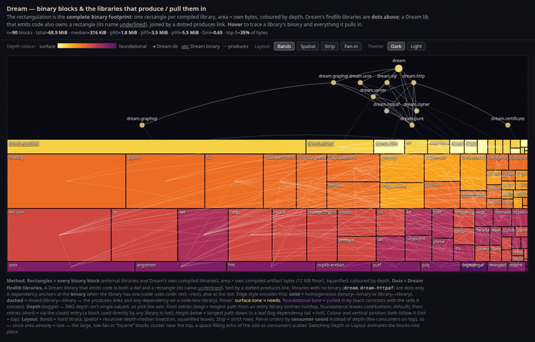

# opam-depmap

Visualise the **library dependency graph** and **binary-size distribution** of any
opam package installed in your switch as two self-contained, offline HTML pages —
no JS frameworks, no build step, no server, no source checkout.



*The dependency map in four depth-ordered layouts (Bands · Spatial · Strip · Fan-in).*

## What you get

- **`squarified_treemap.html`** — the project's **complete binary footprint**.
  - Every compiled library is a rectangle, area ∝ its own compiled-artifact bytes.
  - The project's **own** findlib libraries also appear as **dots above** the
    rectangulation (a library's identity), joined to their binary by a dotted
    *produces* link. Dependency edges are drawn **binary → binary** (solid) or
    **library ↔ binary** (dashed).
  - Colour encodes **dependency depth** (surface ↔ foundational, Inferno ramp).
  - **Hover** any node to trace what it *needs* and what *pulls it in*.
  - Toggle **Layout** (Bands / Spatial / Strip / Fan-in) and **Theme** (Dark / Light).
  - A one-line **size-distribution readout** (n, total, median, p90/p95/p99, Gini,
    top-5 share) sits in the header.

- **`distribution.html`** — the size distribution, built to surface **"bizarre"**
  packages (large own-code carried by few consumers). Charts: **Size vs
  consumers**, **Rank-size (Zipf)**, **Pareto**, **ECDF**.

## Requirements

- `ocamlfind`, `opam`, `python3` (3.8+), and a browser to view the output
- The package to analyse must be **installed** in the current opam switch
  (`opam install <pkg>`, or `opam pin` a local checkout to map your own work).
  Set `OPAMSWITCH` to use another switch.

## Usage

```sh
git clone https://github.com/cuihtlauac/opam-depmap
cd opam-depmap

# Point it at any installed opam package:
make PACKAGE=dream
# -> out/data.json  out/squarified_treemap.html  out/distribution.html
```

Every stage leaves its output in `out/`: the collected data (`data.json`) and
the two pages. Re-running `make` recomputes the data but only rewrites it when
its content changed, so the pages are rebuilt only when something actually moved.

Open the HTML files in a browser (they are fully self-contained — copy them
anywhere). Or run the stages by hand:

```sh
# 1. collect the graph + sizes from the opam switch
DEPMAP_PACKAGE=dream DEPMAP_OUT=/tmp/data.json opam exec -- python3 bin/collect.py

# 2. render (pure python, no opam needed)
DEPMAP_DATA=/tmp/data.json DEPMAP_HTML=/tmp/map.html  python3 bin/build_map.py
DEPMAP_DATA=/tmp/data.json DEPMAP_DIST=/tmp/dist.html python3 bin/build_distribution.py
```

### Configuration

`collect.py` is configured via environment variables:

| variable | meaning | default |
|---|---|---|
| `DEPMAP_PACKAGE` | installed opam package to analyse | *(required)* |
| `DEPMAP_NAME` | display name | `DEPMAP_PACKAGE` |
| `DEPMAP_OWN` | regex matching the project's **own** libraries | `^(<own packages>)([.]\|$)`, own packages = installed packages sharing `DEPMAP_PACKAGE`'s `dev-repo` |
| `DEPMAP_ROOT` | findlib library to root the graph at; the graph is what it transitively requires | `DEPMAP_PACKAGE` |
| `DEPMAP_OUT` | output JSON path | `./data.json` |

## Example

A worked example for [Dream](https://github.com/aantron/dream) is committed under
[`example/dream/`](example/dream/) (regenerate with `make example`) — open `example/dream/squarified_treemap.html`.

## How it works

```
opam switch: ocamlfind (requires closure & install dirs) + opam (dev-repo)
        │
        ▼   bin/collect.py
   data.json  { project, root, nodes:[{id, kind: own|external, self}], edges }
        │
        ├──► bin/build_map.py           -> squarified_treemap.html
        └──► bin/build_distribution.py  -> distribution.html
```

- **Graph:** the findlib `requires` closure of the root library — exactly what
  linking it pulls in (build-only tools and test deps never appear).
- **Own vs external:** a library is *own* if it belongs to an opam package built
  from the same source repo (`dev-repo`) as the analysed package; everything else
  reachable is *external*.
- **Sizes** are compiled-artifact bytes of each library's findlib install dir,
  measured the same way for own and external libs. This is a consistent
  **proxy**, not opam/install size.
- **Depth** is the longest path from an entry library; **colour and vertical
  position both follow it** (entries hot/top, foundational leaves cold/bottom).
- The treemap is **squarified** (Bruls–Huizing–van Wijk); the nesting/ordering
  uses a **dominator tree** and a Sugiyama-style within-band ordering. See
  `CLAUDE.md` for internals.

## Recording the layout video

The GIF above is produced by screenshotting each layout and cross-fading them:

```sh
# capture the four settled layouts
for L in Bands Spatial Strip Fan-in; do
  python3 - "$L" <<'PY'
import sys, pathlib
h = pathlib.Path("out/squarified_treemap.html").read_text()
clk = f"[...document.querySelectorAll('.schemebtn')].find(b=>b.textContent==='{sys.argv[1]}')?.click()"
h = h.replace("</body>", f"<script>addEventListener('load',()=>setTimeout(()=>{clk},400))</script></body>")
pathlib.Path("/tmp/cap.html").write_text(h)
PY
  google-chrome --headless --disable-gpu --virtual-time-budget=1600 \
    --window-size=1280,820 --screenshot="/tmp/$L.png" "file:///tmp/cap.html"
done

# cross-fade them into an mp4, then an optimised looping gif
ffmpeg -y -loop 1 -t 1.6 -i /tmp/Bands.png -loop 1 -t 1.6 -i /tmp/Spatial.png \
       -loop 1 -t 1.6 -i /tmp/Strip.png  -loop 1 -t 1.6 -i /tmp/Fan-in.png \
  -filter_complex "[0][1]xfade=fade:0.5:1.1[a];[a][2]xfade=fade:0.5:2.2[b];\
[b][3]xfade=fade:0.5:3.3,format=yuv420p,scale=1000:-2[v]" -map "[v]" -r 20 /tmp/layouts.mp4
ffmpeg -y -i /tmp/layouts.mp4 -vf "fps=15,scale=900:-2,palettegen" /tmp/pal.png
ffmpeg -y -i /tmp/layouts.mp4 -i /tmp/pal.png -lavfi "fps=15,scale=900:-2[x];[x][1:v]paletteuse" -loop 0 docs/layouts.gif
```

For the *smooth* FLIP transitions (not just cross-fades) use a browser automation
tool that records video — e.g. Playwright's built-in recorder driving the clicks.
GitHub renders a committed GIF inline via ``; MP4s can be
attached to a release or the repo and embedded with a `<video>` tag.

## License

[MIT](LICENSE) © Cuihtlauac ALVARADO
